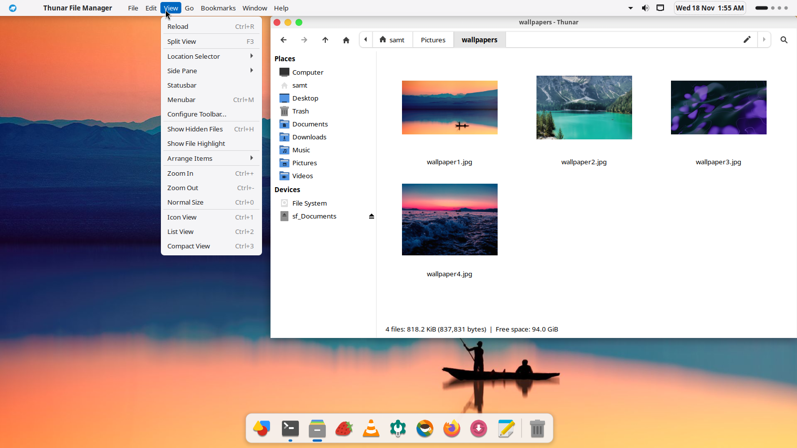
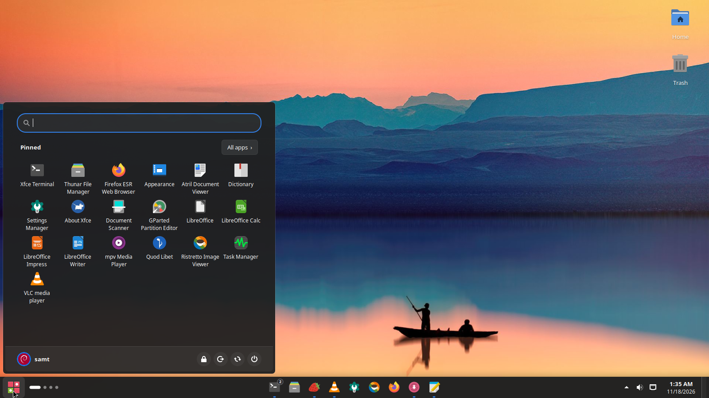
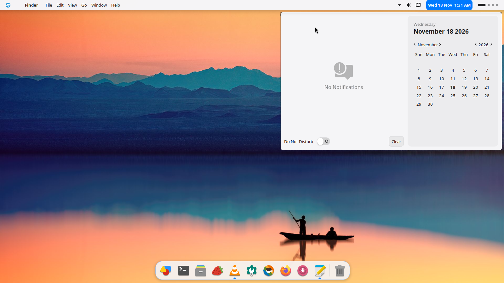

# Ultimate Shell for XFCE

**xfce4-ultimate-shell** is an XFCE panel plugin that turns the panel into a complete
desktop shell, in two styles you can switch between at any time:

- **macOS style** — top bar with the Apple-style system menu, a global menu
  (the app's menus in the top bar, with keyboard shortcuts), window buttons and a
  magnifying **dock** with Launchpad.
- **Windows style** — taskbar with Start menu, live window thumbnails, system tray
  and clock, in several panel layouts (classic, centered Windows 11, …).

> **Status: beta (0.4.0).** It is used daily and tested on XFCE 4.20 / Debian, but expect
> rough edges. X11 only — Wayland is not supported.

| macOS layout | Windows layout |
|---|---|
|  |  |

<p align="center"></p>

---

## Features

**Layouts & panel**
- macOS and Windows layouts with one switch; four Windows panel layouts (Start + taskbar
  left or centered, workspaces left/right)
- Workspace indicator (GNOME-style pills, dots or numbers; click, scroll, right-click menu)
- Animations (Off / Subtle / Full, adjustable speed) and a desktop-compositing switch

**Appearance**
- One colour system for the whole shell: *Follow GTK theme*, *Light*, *Dark* or *Custom*
  (background, text and accent with transparency) - panel, dock, popups, menus, search
  fields and the settings window all follow it
- Shell themes: save, apply, import and export your look (colours, font, shapes,
  indicators, GTK / icon / title-bar themes); built-in macOS and Windows 11 themes
- Frameless panel with its own soft shadow; panel and dock opacity

**Dock (macOS)**
- Magnification, auto-hide, positions bottom/left/right, hover name labels
- Badges and progress bars sent by apps (e.g. unread mail, Firefox downloads)
- Drop a file on an icon to open it with that app
- Launchpad (fullscreen app grid with categories and GNOME-style page dots)

**Taskbar (Windows)**
- Grouped apps, pinning, live window thumbnails on hover
- Indicator styles (Windows 11 / 10 / Plasma) with their own colours; app badges and
  progress bars; drop files on an icon to open them
- Full right-click menus: windows list, app actions (e.g. *New Private Window*),
  run as administrator, edit launcher, minimize/restore all, move to workspace, force quit

**Start menu** — five styles: Default, Windows 7, Windows 11, Whisker (list or icons), Launchpad
- Search by name, description, keywords and program; Enter opens the top result
- Built-in calculator (`12*7` → 84) and "Search the web"
- "New" badge and *Recently added* for newly installed apps; optional *Recent &
  Recommended* (most used apps, recent files)
- Favorites with drag-to-reorder (Windows 11 style), resizable by dragging the edges

**Top bar (macOS)**
- Global menu for GTK, GtkApplication and Qt apps, with shortcuts shown; menus that
  don't fit move into a » menu
- *About This Computer*, *Force Quit*, *Recent Items*; window buttons on the left or right,
  with every window's title-bar buttons following

**System tray**
- Sound popup: output/input sliders and device choice, now-playing cards with album art,
  seek bar and controls, per-app volume
- Microphone-in-use indicator, Bluetooth (pairing, audio profiles), removable drives,
  battery/power profiles/brightness, network, clipboard history
- Overflow menu with drag-to-rearrange; StatusNotifier and XEmbed icons

**Clock & calendar** — Windows 7 / 10 / 11 and GNOME-macOS flyouts (the GNOME one shows
your notifications); many date formats, week numbers, follows time-zone changes

**Notifications** — full notification server with history, grouping and Do Not Disturb

---

## Requirements

XFCE 4.18 or newer (developed on 4.20), GTK 3.24, X11.

**Debian / Ubuntu**
```sh
sudo apt install build-essential meson ninja-build pkg-config \
  libgtk-3-dev libxfce4panel-2.0-dev libxfce4ui-2-dev libxfce4util-dev libxfconf-0-dev \
  libwnck-3-dev libx11-dev libxtst-dev libdbusmenu-gtk3-dev
```

**Fedora**
```sh
sudo dnf install gcc meson ninja-build gtk3-devel xfce4-panel-devel libxfce4ui-devel \
  libxfce4util-devel xfconf-devel libwnck3-devel libX11-devel libXtst-devel libdbusmenu-gtk3-devel
```

**Arch**
```sh
sudo pacman -S --needed base-devel meson ninja gtk3 xfce4-panel libxfce4ui libxfce4util \
  xfconf libwnck3 libx11 libxtst libdbusmenu-gtk3
```

**Optional, recommended**
- `appmenu-gtk3-module` (`appmenu-gtk-module`) — global menu for GTK apps
- `pavucontrol` — "Mixer…" button; `xfce4-taskmanager` — Task Manager entry
- `bluez` — Bluetooth; `upower`, `power-profiles-daemon` — power section

## Build & install

```sh
git clone https://github.com/eixert23/xfce4-ultimate-shell.git
cd xfce4-ultimate-shell
meson setup build
ninja -C build
sudo ninja -C build install
xfce4-panel -r
```

> Building inside a VirtualBox shared folder? Build into a folder in your home instead
> (`meson setup ~/build-ultimate`) to avoid clock-skew errors.

Then: right-click the panel ▸ **Panel ▸ Add New Items…** ▸ **Ultimate Shell**.

### Debian / Ubuntu package (.deb)

```sh
sudo apt install dpkg-dev          # once, in addition to the build dependencies
sh packaging/build-deb.sh
sudo apt install ./xfce4-ultimate-shell_*.deb
xfce4-panel -r
```
The package installs into `/usr`, works out its library dependencies automatically and can
be removed with `sudo apt remove xfce4-ultimate-shell`.
Open its settings with right-click ▸ **Properties** (or *Ultimate Shell Settings* in the
Start / Launchpad right-click menu).

## Uninstall

1. In Ultimate Shell Settings ▸ **Top Bar**, untick *Also move every window's title-bar
   buttons* (puts your own XFCE setting back), and in **System Tray** untick
   *Use the modern tray icon for IBus*.
2. Remove the plugin from the panel, then:
   ```sh
   sudo ninja -C build uninstall
   xfce4-panel -r
   ```
3. See *What it changes on your system* below for anything else you want to undo.

---

## What it changes on your system

Ultimate Shell only changes things outside the panel when a feature needs them.
Everything below can be undone.

| What | Why | How to undo |
|---|---|---|
| Adds `appmenu-gtk-module` and `ultimate-accels-gtk-module` to XSETTINGS **Gtk/Modules** (macOS layout) | Global menu and its shortcuts for GTK apps | Switch to the Windows layout (removes them), or edit with `xfconf-query -c xsettings -p /Gtk/Modules` |
| Installs `libultimate-accels-gtk-module.so` into the GTK 3 modules folder | Publishes menu shortcuts for the global menu | Removed by `ninja uninstall` |
| Writes `widget.gtk.global-menu.enabled` to Firefox's `user.js` (macOS layout) | Firefox's own global-menu support | Switch to the Windows layout, or delete that line from `user.js` in your Firefox profile |
| Sets xfwm4 `/general/button_layout` and XSETTINGS `/Gtk/DecorationLayout` | Window title-bar buttons on the same side as the top-bar buttons | Untick *Also move every window's title-bar buttons* — your original values are restored |
| Can switch xfwm4 `/general/use_compositing` | *Desktop compositing* switch in General ▸ Effects | Same switch, or Window Manager Tweaks ▸ Compositor |
| Restarts IBus once with `XDG_CURRENT_DESKTOP=KDE` | Makes the IBus icon a modern tray icon that can go into the overflow menu | Untick *Use the modern tray icon for IBus* |
| Changes the number of workspaces (only when you ask) | Workspaces page / indicator menu | Same place, or Workspace settings |
| Saves app launch counts in `~/.config/ultimate-shell/app-usage.ini` | *New* badges, *Recently added*, *Most used* | *Clear App History* in Start Menu settings, or delete the file |

All plugin settings live in the `xfce4-panel` xfconf channel under
`/plugins/ultimateshell/`. **Export / Import / Reset** are on the About page of the settings.

### Things that ask for your password
*Run as Administrator* and *Terminal (Admin)* use `pkexec` (polkit). Nothing runs as root
unless you choose it and confirm the password prompt.

## Privacy
Nothing leaves your computer. App usage history is stored only in the file above; recent
files come from GTK's standard recent-files list. *Search the web* opens DuckDuckGo in
your browser only when you click it.

## Known limitations
- X11 only (uses libwnck and X11 window properties).
- Apps running as root (GParted, Synaptic) keep their in-window menu — exporting a root
  app's menu to your session would let any program click its menu items.
- Some Qt / Electron apps draw their own title-bar buttons and ignore the button-side setting.
- Album art in the sound popup depends on what the player reports (browsers vary).
- Old XEmbed tray icons must stay on the panel (they cannot be moved into the overflow menu).
- No window or workspace animations (minimize, Magic Lamp, wobbly windows, workspace slide).
  Those have to be drawn by the compositor, and xfwm4's compositor has no effects API.
  See *Window effects* below.

## Window effects
The shell animates what it draws itself (dock, popups, Launchpad, indicators). For
window effects, swap the compositor or window manager; the shell keeps working because
it only uses libwnck:

- **Compiz**: replaces xfwm4 and brings Magic Lamp, Wobbly Windows, workspace slide and
  more. Run `compiz --replace` (and `xfwm4 --replace` to go back).
- **picom**: keep xfwm4, turn off its compositor (Settings → Window Manager Tweaks →
  Compositor), then run picom with animations enabled in `~/.config/picom.conf`.
  It does open, close and resize animations, not Magic Lamp or Wobbly.

## Contributing
Bug reports with your XFCE version, distribution and a screenshot help a lot.
Build with `meson setup build && ninja -C build`; please keep the build free of warnings.

## License
GPL-2.0-or-later — see [LICENSE](LICENSE).
